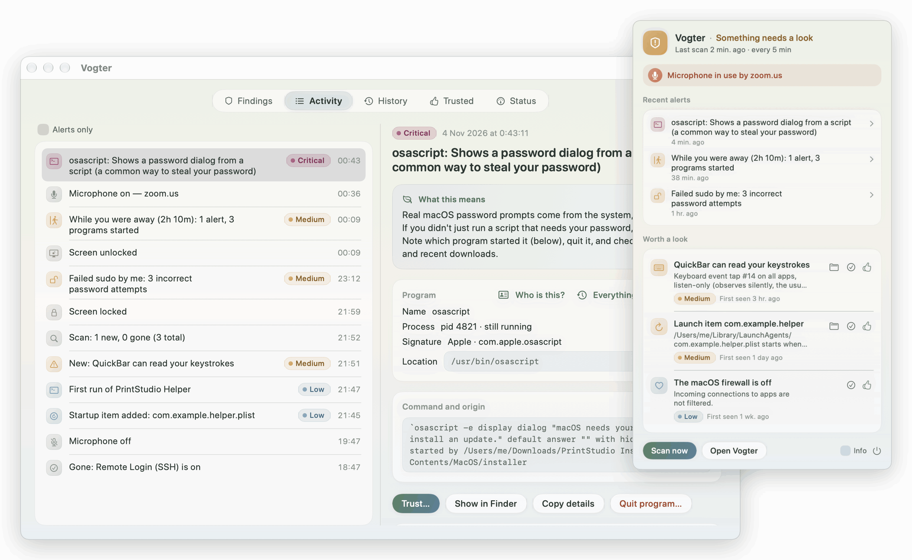
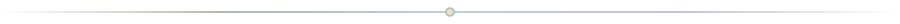
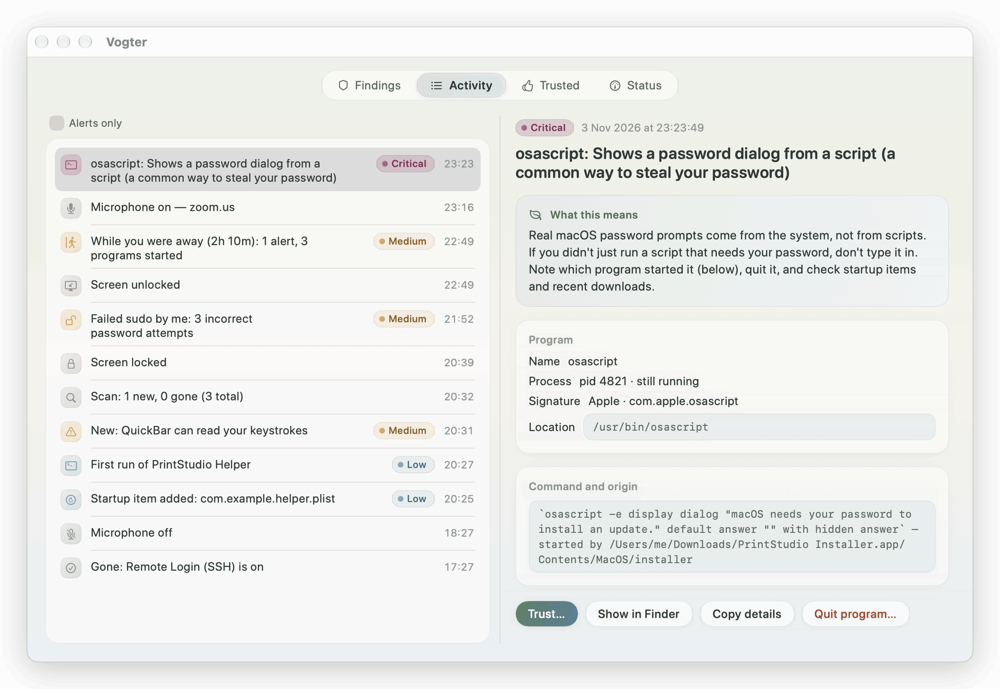
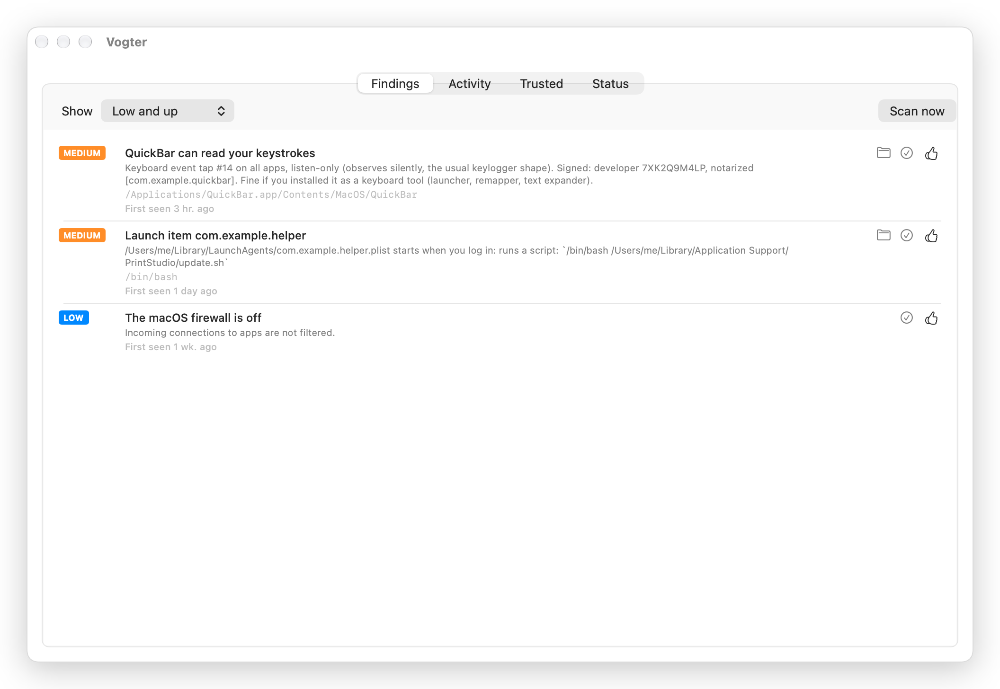
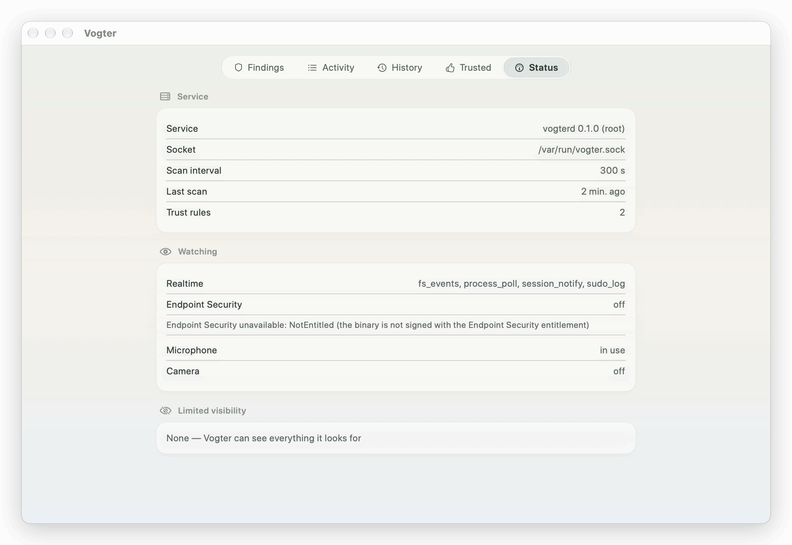

<p align="center">
  
</p>

<div align="center">


# Vogter

*A quiet guardian for your Mac.*

Vogter keeps a gentle eye on your Mac, noticing keyloggers, sneaky startup items,
info-stealers, and anyone using it while you're away. When everything is calm it stays out of
your way. When something deserves a look, it tells you plainly what it saw and what you can do.

[](https://github.com/schlunsen/vogter/releases/latest)
[](https://github.com/schlunsen/vogter/actions/workflows/ci.yml)
[](#install)
[](LICENSE)

</div>

<picture>
  <source media="(prefers-color-scheme: dark)" srcset="docs/images/hero-dark.png">
  
</picture>

<sub>Screenshots use made-up demo data (`scripts/screenshots.sh`).</sub>

<p align="center"></p>

## A calm presence in your menu bar

Vogter lives as a small icon in your menu bar. Most of the time it simply rests there.

- When something **needs a look**, the icon changes and you get a notification that explains,
  in plain words, what happened and whether it's likely fine.
- While your **microphone or camera** is in use, a small indicator appears next to it.
- **Everything happens on your Mac.** Nothing is sent anywhere.

## What it gently watches

<table>
  <tr>
    <td width="25%"></td>
    <td width="25%"></td>
    <td width="25%"></td>
    <td width="25%"></td>
  </tr>
  <tr>
    <td align="center"><sub>Who can read your keystrokes</sub></td>
    <td align="center"><sub>What starts with your Mac</sub></td>
    <td align="center"><sub>When the mic or camera listens</sub></td>
    <td align="center"><sub>What happened while you were away</sub></td>
  </tr>
</table>

- **Your keyboard.** Programs that listen to your keystrokes, and apps you've given *Input
  Monitoring* or *Accessibility* permission. A signed keyboard tool you installed gets a soft
  mention. An unsigned one, or one running from a Downloads or temp folder, gets a clear one.
- **Your privacy permissions.** Which apps may record your screen, read all your files, or use
  your camera and microphone, and whether those apps are properly signed.
- **What starts with your Mac.** Things that launch at login or boot: scripts, unsigned
  programs, and items pretending to be Apple's.
- **Programs as they start.** Fake password dialogs (the way info-stealers like AMOS ask for
  your password), Keychain dumping, `curl … | sh`, hidden encoded commands, Gatekeeper being
  turned off, the "downloaded from the internet" flag being removed, new user accounts, scripts
  typing into other apps, and unsigned programs in temp or Downloads folders.
- **Your microphone and camera.** A notification as soon as either turns on, naming the app
  that's using the microphone.
- **Your time away.** Every `sudo` (and failed password attempts), screen lock and unlock, and a
  short summary when you come back: *"While you were away (2h 10m): 1 alert, 3 programs
  started"*.
- **macOS's own protections.** System Integrity Protection, Gatekeeper, FileVault and the
  firewall, plus whether **Remote Login (SSH)** or **Screen Sharing** is switched on, and
  programs accepting connections from the network.

With Apple's Endpoint Security (see [below](#first-run)), Vogter can also see programs reading
your Keychain, browser passwords and cookies, SSH keys and Messages, along with SSH logins,
screen-sharing sessions and XProtect malware detections.

<p align="center"></p>

## When something needs a look

<picture>
  <source media="(prefers-color-scheme: dark)" srcset="docs/images/activity-dark.png">
  
</picture>

Click an alert in the menu or in the notification, and Vogter opens it for you:

- **What this means.** Why it's worth a look, and when it's perfectly fine.
- **The program.** What ran, whether it's still running, who signed it, where it lives, the
  exact command, and what started it.
- **Trust…** "I know this app, you can relax about it." Choose this kind of alert, or all of
  them.
- **Show in Finder**, **Copy details**, and **Quit program…** (a polite request to quit, like
  Activity Monitor) while it's still running.

On the **Findings** tab, which lists things that are true *right now* such as a keyboard tap or
a startup item, the check mark means "I know about this one". It stays hidden until it goes
away and comes back.

**Trust can't be borrowed.** A signed app is trusted by its developer's Apple ID, which a
lookalike can't copy. An unsigned file is trusted by its exact contents, so if it's ever
swapped for something else, the trust ends. Apple's own tools (like `bash`) are only trusted
for one specific alert, since they can run anything. The **Trusted** tab shows your rules, and
you can remove them at any time.

**Vogter learns your rhythm.** For the first week it quietly notes which programs you use.
After that, a program running for the first time is mentioned. Programs you use all the time
(20+ runs over 3+ days) have their low and medium launch alerts softened by one level. High and
critical alerts are never softened.

<table>
  <tr>
    <td><picture><source media="(prefers-color-scheme: dark)" srcset="docs/images/findings-dark.png"></picture></td>
    <td><picture><source media="(prefers-color-scheme: dark)" srcset="docs/images/status-dark.png"></picture></td>
  </tr>
  <tr>
    <td align="center"><sub>Findings</sub></td>
    <td align="center"><sub>Status</sub></td>
  </tr>
</table>

<p align="center"></p>

## Install

### Homebrew

```sh
brew install --cask schlunsen/vogter/vogter   # the menu bar app
brew install schlunsen/vogter/vogter          # the command-line tools and service
brew services start vogter                    # start watching
```

The app is signed with a Developer ID and notarized by Apple, so it opens without warnings.
More in [docs/homebrew.md](docs/homebrew.md).

### Download

Grab `Vogter-<version>-macos-arm64.zip` from the
[latest release](https://github.com/schlunsen/vogter/releases/latest), unzip it, and move
**Vogter.app** to your Applications folder.

### Build from source

You'll need macOS 14 or later, [Rust](https://rustup.rs) 1.88+ (edition 2024) and Xcode 16+
(Swift 6 tools).

```sh
git clone https://github.com/schlunsen/vogter.git && cd vogter
scripts/build-app.sh                      # builds build/Vogter.app (with vogterd and vogter inside)
cp -R build/Vogter.app /Applications/
```

## First run

Vogter has two parts: a background **service** (`vogterd`) that does the watching, and the
**menu bar app** where you see what it noticed. The app finds the service on its own.

1. **Start the service.** With Homebrew, run `brew services start vogter`. To have it run as
   root at boot, so it can see every process, use:

   ```sh
   sudo scripts/install-daemon.sh            # after copying Vogter.app to /Applications
   ```

2. **Grant Full Disk Access**, so Vogter can see which apps hold privacy permissions. Open
   **System Settings → Privacy & Security → Full Disk Access**, click **+**, press
   <kbd>⌘</kbd><kbd>⇧</kbd><kbd>G</kbd> and enter the path to `vogterd`. For the app
   install that's `/Applications/Vogter.app/Contents/Helpers/vogterd`; for Homebrew, use the
   path printed by `realpath "$(brew --prefix)/bin/vogterd"`. Then restart the service.

3. **Open Vogter** and **allow notifications** when asked.

The first scan is a baseline: what's already on your Mac is listed but doesn't alert you.
After that, only *changes* do. To remove the root service, run
`sudo scripts/install-daemon.sh uninstall`.

**Endpoint Security**, Apple's kernel event feed, would give Vogter its clearest view: every
program launch, reads of secret files, logins. It needs a special entitlement from Apple that
this project doesn't have yet, so for now Vogter uses its gentler fallback watchers. The
Status tab shows which ones are active. See
[docs/endpoint-security.md](docs/endpoint-security.md).

## From the terminal

`vogter` talks to the running service. The exceptions are `scan` and `inventory`, which work
on their own.

| Command | What it does |
| --- | --- |
| `vogter scan [-s info\|low\|medium\|high\|critical] [--json]` | One-shot scan and report, no service needed (`sudo` also sees root processes) |
| `vogter status` | Last scan, open findings, mic/camera, realtime sources |
| `vogter findings [--all]` | Open findings with their keys (`--all` includes acknowledged ones) |
| `vogter events [-n 30]` | Recent activity with ids |
| `vogter show <id>` | Everything known about one event |
| `vogter trust <key>` / `vogter trust --event <id> [--all-checks]` | Trust what a finding or event is about |
| `vogter trusted` | List trust rules |
| `vogter untrust <id>` | Remove a trust rule |
| `vogter ack <key>` | Hide a finding until it goes away and comes back |
| `vogter watch` | Live event stream |
| `vogter scan-now` | Ask the service to look right away |
| `vogter inventory [processes\|taps\|tcc\|launchd\|cron\|listeners\|health]` | Raw sensor data as JSON |

<p align="center"></p>

## Your privacy

- **Everything stays on your Mac.** History lives in a small SQLite database in
  `~/Library/Application Support/Vogter/` (or `/Library/Application Support/Vogter/` when the
  service runs as root). Vogter makes no network connections: no telemetry, no cloud lookups,
  nothing phoning home.
- **Secrets are wiped from what it records.** Passwords, tokens and API keys in command lines
  (`--password=…`, `Authorization:` headers, `https://user:pass@…`, GitHub, AWS and Slack-style
  tokens) are replaced with `[redacted]` before anything is stored or shown.
- **Only you and root can talk to the service.** When it's signed, Vogter also only accepts
  apps signed by the same developer.

## Honest limits

- **Without Endpoint Security, very brief programs can slip by.** The fallback watcher looks
  for new programs every second, so something that starts and exits faster than that may go
  unseen. Reads of secret files and SSH logins aren't visible at all without it.
- **The camera alert can't yet say which app** is using it. The microphone alert can.
- **Endpoint Security needs Apple's entitlement**, which takes a request to Apple and a paid
  developer account. Until then, [docs/endpoint-security.md](docs/endpoint-security.md)
  explains how to test in a VM.
- **It isn't an antivirus.** Vogter doesn't scan files for known malware. It watches for
  *behaviour*: spying, persistence, tampering. Keep macOS's built-in XProtect and Gatekeeper on,
  and Vogter will tell you if they're off.
- **It's young software (v0.1).** Expect a few rough edges, and please
  [open an issue](https://github.com/schlunsen/vogter/issues) when you find one.

## For developers

Rust does the watching and SwiftUI shows it:

```
crates/vogter-model    shared types and secret redaction
crates/vogter-sensors  gathers facts: signatures, event taps, TCC, processes, sockets, startup items, health, mic/camera
crates/vogter-detect   the rules: facts -> findings, program launches -> alerts, trust (pure, unit-tested)
crates/vogter-es       Endpoint Security client
crates/vogter-store    SQLite history
crates/vogter-ipc      daemon <-> client protocol (JSON lines over a Unix socket)
crates/vogterd         the service
crates/vogter-cli      the `vogter` command
app/                   SwiftUI menu bar app (SwiftPM)
```

```sh
cargo test                        # Rust: rules, store, protocol, redaction
swift test --package-path app     # Swift: protocol decoding against captured daemon output
cargo run --release -p vogterd    # run the service as your user
scripts/screenshots.sh            # regenerate docs/images from demo data
scripts/notarize.sh               # notarize a Developer ID build (see the script for setup)
```

[docs/design.md](docs/design.md) explains how the checks, realtime watchers, trust and learning
work, the socket security model, and why Vogter isn't built on Rustinel.

### Where it's heading

1. **Scanner** (done): one-shot `vogter scan`.
2. **Service and app** (done): timed scans with history, change alerts, mic and camera alerts,
   the menu bar app.
3. **Realtime** (done): live program checks, startup and permission folder watching, sudo, and
   lock/unlock with an away summary. The Endpoint Security client is built and waits for
   Apple's entitlement.
4. **Trust and learning** (done).
5. **Releases** (done): notarized builds and a Homebrew tap.
6. **Next:** Sigma rules via `rsigma-eval`, YARA scanning of new binaries via `yara-x`, and a
   Network Extension for per-app network control.

With gratitude to the ideas in [Objective-See](https://github.com/objective-see)'s tools (ideas
only, since they're GPL), [Santa](https://github.com/northpolesec/santa) and
[Mac Monitor](https://github.com/Brandon7CC/mac-monitor).

## License

[Apache-2.0](LICENSE). Illustrations were generated for this project and live in `docs/images/`.
